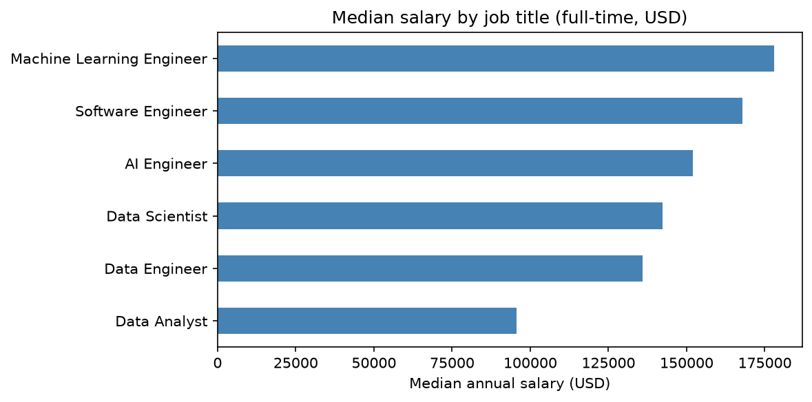
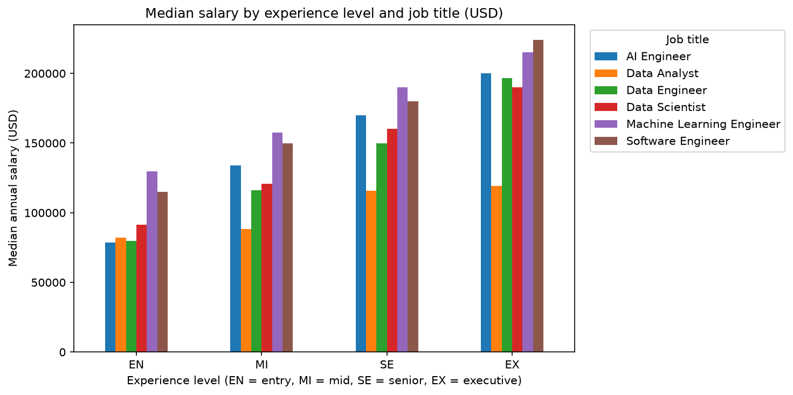
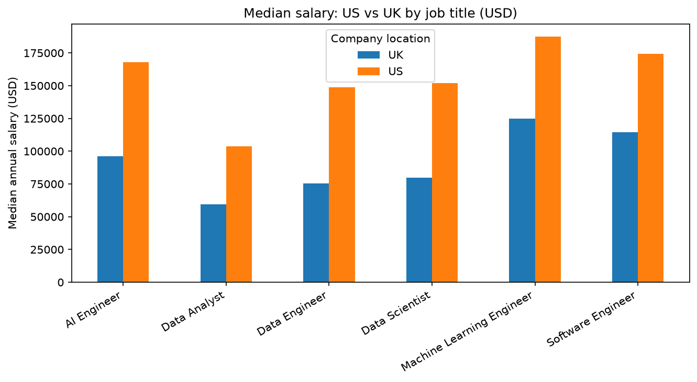

# The AI Engineer Job Market: Salaries, Experience and Remote Work

## Overview
Comparing AI/ML engineer roles with other data and software roles, globally
and in the UK.

## Data Source
- **Dataset:** aijobs.net Global AI, ML, Data Science Salary Index (`salaries.csv`)
- **Repository:** https://github.com/foorilla/ai-jobs-net-salaries
- **Original source:** anonymous salary survey at [aijobs.net/salaries](https://aijobs.net/salaries)
- **Coverage:** global AI/ML/Big Data salaries, 2021-2025
- **Licence:** CC0-1.0 (public domain). Attribution is appreciated, so credit goes to aijobs.net.
- **Date downloaded:** 04-11-2026
- **Size:** 151,445 rows, 11 columns (reduced to 71,913 after removing duplicates)

## Project Files
- `Final_Project.ipynb`: analysis notebook
- `salaries.csv`: raw data
- `Project_Scope.md`: project plan

## Methods
(Brief summary of cleaning and analysis steps. Fill in at the end.)

## Key Findings
(To be completed after analysis.)

## Limitations
- Data is mostly from the USA; UK sample is small
- Duplicate rows removed (79,532); identical rows may sometimes be genuine

# The AI Engineer Job Market: Salaries, Experience and Remote Work

## Overview
This project compares AI and machine learning engineer roles with other data and software roles, looking at salary, experience level and remote work, globally and in the UK.

## Key Findings
- Machine Learning Engineer has the highest median salary (178,000 USD), followed by Software Engineer and AI Engineer (151,898 USD).
- Pay rises with experience for every role. AI Engineer starts lowest at entry level but grows fastest.
- UK salaries are about half to two-thirds of US salaries for the same job titles.
- Fully remote roles pay slightly more than on-site roles (about 4%).

## Data Source
- Dataset: aijobs.net Global AI, ML, Data Science Salary Index (`salaries.csv`)
- Repository: https://github.com/foorilla/ai-jobs-net-salaries
- Original source: anonymous salary survey at aijobs.net/salaries
- Licence: CC0-1.0 (public domain)
- Date downloaded: [add the date]

## Methods
1. Removed 79,532 duplicate rows (151,445 to 71,913 rows).
2. Kept six job titles and full-time roles only (29,819 rows).
3. Calculated median salaries by job title, experience level and country (US vs UK).

## Limitations
- Self-reported survey data, mostly from the US.
- Small UK sample (1,269 rows; only 38 AI Engineers).
- Results show associations, not causes.

## Project Files
- `Final_Project.ipynb`: full analysis
- `salaries.csv`: raw data
- `Project_Scope.md`: project plan